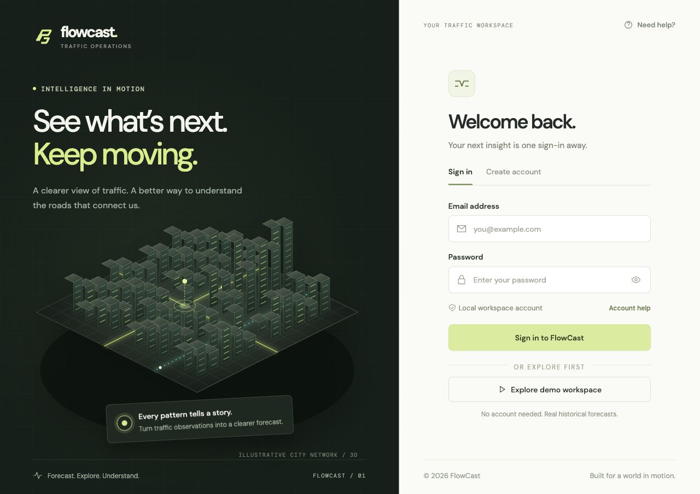
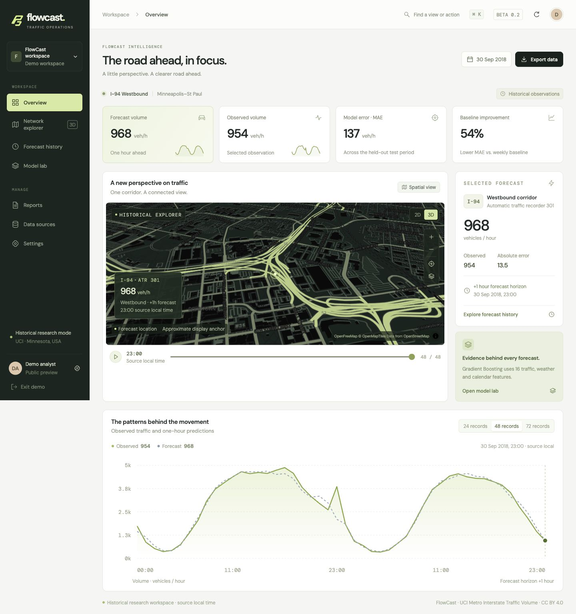

# FlowCast

FlowCast is an internship project for forecasting hourly traffic volume and presenting the result in an interactive 3D traffic dashboard. The first release uses the UCI Metro Interstate Traffic Volume dataset and predicts traffic one hour ahead for the represented I-94 corridor.

## Current milestone

The active one-month build runs from 23 November to 23 December 2026. The committed core includes:

- a reproducible data pipeline with chronological evaluation;
- persistence and weekly seasonal baselines;
- a gradient boosting traffic-volume model;
- a FastAPI inference service;
- a redesigned React workspace with overview, network explorer, forecast history, model lab, reports, data sources and settings;
- an isometric login page with working local account creation, sign-in and sign-out;
- a MapLibre 3D/2D map, historical replay, chart selection, CSV/JSON export and print-friendly report;
- 30 backend tests covering data leakage, forecasting contracts and session authentication.

Congestion, travel-time, accident-risk, and live-city claims require additional matching datasets. See [the mentor report](MENTOR_REVIEW_REPORT.md) and [roadmap](ROADMAP.md) for scope and review points.

## Local setup

Requirements: Python 3.11 or later and Node.js 22.12 or later.

```bash
python3 -m venv .venv
source .venv/bin/activate
python -m pip install -r requirements-dev.txt
python -m ml.download_data
python -m ml.train
uvicorn api.main:app --reload --port 8000
```

In another terminal:

```bash
cd frontend
npm install
npm run dev
```

The API documentation is available at `http://localhost:8000/docs` and the dashboard at `http://localhost:5173`.

## Local accounts

Choose **Explore demo workspace** for public historical forecasts, or create a local account with a name, email and password of at least 10 characters. Account data lives in ignored `artifacts/accounts.sqlite3`; `FLOWCAST_AUTH_DB` can override the path. Passwords use salted scrypt and session cookies are HttpOnly. These accounts do not verify email ownership or support password recovery. Traffic endpoints remain public.

For a future HTTPS deployment, set `FLOWCAST_COOKIE_SECURE=true`, configure `FLOWCAST_ALLOW_ORIGINS` explicitly and use a same-origin reverse proxy for `/api`. The current limiter is process-local and is not a distributed production abuse-control system.

## Verification

```bash
pytest
ruff check .
cd frontend && npm run check && npm run build
```

## Data source

The project uses [Metro Interstate Traffic Volume](https://archive.ics.uci.edu/dataset/492/metro+interstate+traffic+volume), donated by John Hogue to the UCI Machine Learning Repository. It contains hourly westbound I-94 traffic-volume observations for Minneapolis–St Paul from 2012–2018 with weather and holiday attributes. The dataset is licensed under CC BY 4.0.

The demo represents that historical corridor and period. It does not represent live or local Indian traffic.

## Measured result

The current gradient boosting model was selected on a chronological validation period. On the held-out April–September 2018 test period it achieved MAE **136.95 vehicles/hour** and RMSE **206.83 vehicles/hour**. The weekly seasonal baseline recorded MAE **297.79 vehicles/hour**. Generated artifacts and evaluation JSON remain local and can be reproduced with `python -m ml.train`.

## Project documents

- [Mentor review report](MENTOR_REVIEW_REPORT.md)
- [One-month roadmap](ROADMAP.md)
- [Dataset card](docs/DATASET.md)
- [Manual tasks for the project owner](docs/MANUAL_TASKS.md)

## Preview




